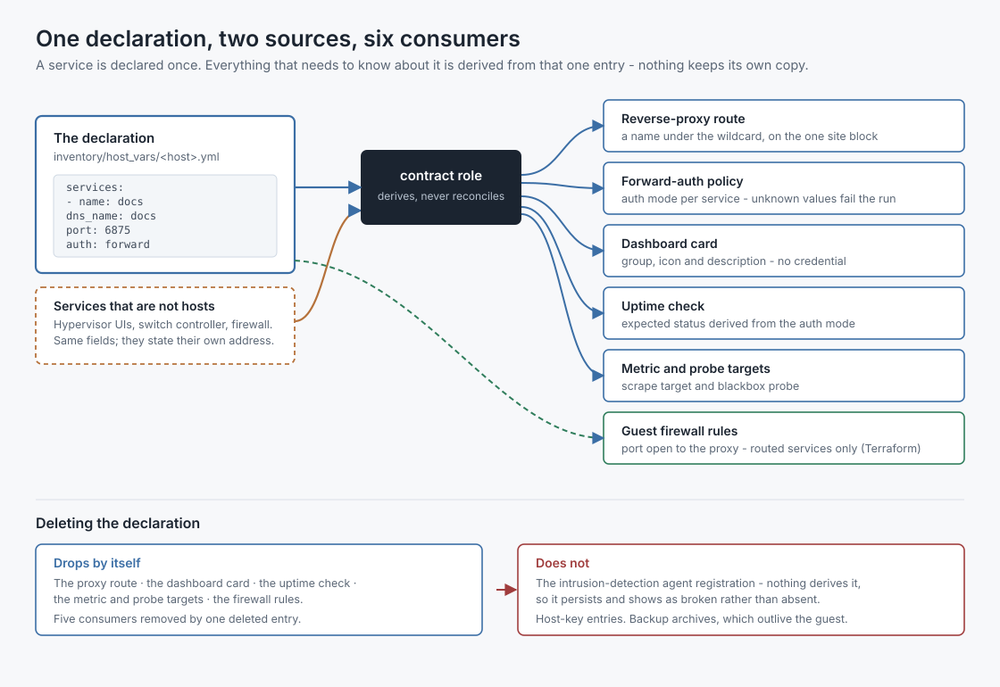
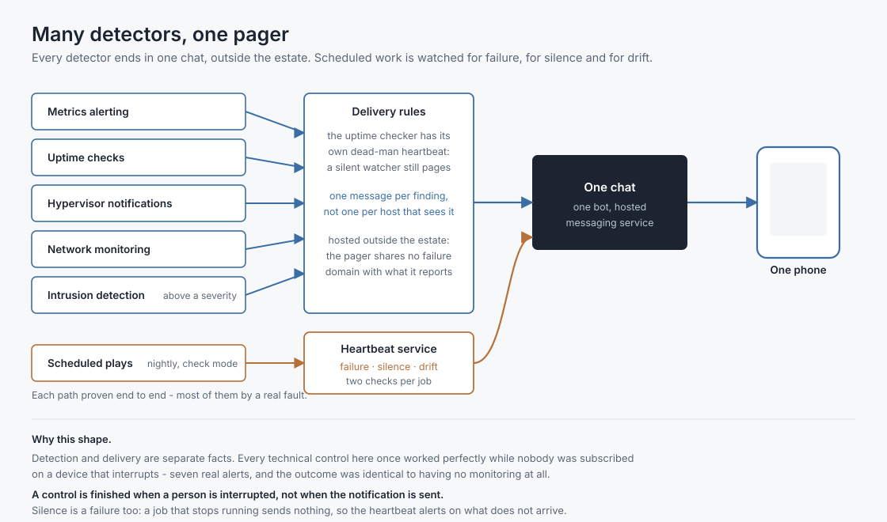

# jeffnet-homelab
Documentation of my homelab and home network - architecture, reusable patterns, lessons learned, and security-focused improvements.

It covers the whole environment rather than one rack: a segmented network behind a firewall doing
all inter-VLAN policy, a three-node Proxmox cluster built with Terraform and Ansible, the
self-hosted services on top of it, home automation and cameras, and the smaller builds that don't
belong to any of those.

The findings are the point. The build took weeks; going back through it service by service has
produced more than the build did, and almost all of it in what things leave behind rather than in
the things themselves.

> **Scope note.** This is documentation, not the estate. The infrastructure code lives in a private
> repository; nothing here is generated from it and nothing here is applied to anything. Internal
> names, addresses and identifiers are substituted throughout - see [SETUP.md](SETUP.md).

---

## Where to start

| If you want | Read |
|---|---|
| The cluster, Terraform, Ansible, credential scopes | [docs/platform/](docs/platform/README.md) |
| The estate, and how a service is declared | [docs/services/](docs/services/README.md) |
| The home side - IoT, cameras, automation | [docs/home/](docs/home/README.md) |
| How a service gets deployed, and reviewed | [docs/operations/](docs/operations/reviewing-a-service.md) |
| **The interesting part** | [docs/findings/](docs/findings/) |
| The rules that came out of it | [docs/principles/](docs/principles/README.md) |
| Code you can lift | [examples/](examples/) |

---

## The environment in one page

**Network** - seven VLANs behind a firewall that is both gateway and the only inter-VLAN policy
point, with a managed switch carrying tagged trunks. It was six until the interface table was read
instead of the notes. The missing one was the *native* VLAN - the one nobody configures
deliberately, and the one the wireless access points need in order to adopt at all.

The segmentation write-up is not published. An earlier draft asserted a rule count that a later
export of the live policy table disproved, and it was withdrawn rather than patched: a page written
from notes about a firewall is a page about the notes. What the export actually showed has its own
lesson, and it generalises beyond one device - **a granular rule sitting above a catch-all is a
logging category, not a control.** Every careful rule below a permissive one classifies traffic that
was already allowed.

**Platform** - three Proxmox nodes in a cluster, every guest declared in Terraform, configuration by
Ansible from a dedicated controller. Two plays run estate-wide on a schedule. Guests are containers
except where the workload forbids it.

**Ingress** - one reverse proxy, one site block, one wildcard certificate over DNS-01, one
split-horizon wildcard DNS record. A service is declared once and *derived* into its proxy route,
dashboard card, uptime check, metric targets - and its firewall rules. Adding one is an entry, never
a block; deleting one removes all of them by itself.

**Guest firewall** - every service guest drops unsolicited inbound traffic at the hypervisor, and its
allow-list is **generated from the same declaration**: the reverse proxy may reach each routed
service's port, the uptime checker the ones that sit behind forward-auth, admin hosts may SSH and the
metrics host may scrape. Everything else is an explicit, commented exception - and only two services
are open to every client: DNS and the ingress itself. It rolled out from a single canary to the
ingress, one wave at a time, and the two resolvers never rebooted in the same change. The firewall is
its own Terraform project with its own token and role, kept off CI. That role is narrower than an
administrator and wider than its name: the hypervisor will not write cluster-level firewall rules
without a system-wide *modify* privilege, which is written down rather than pretended away.

**Inventory** - one source of truth for what runs where, populated from the repository rather than
the other way round. It exists because "which host holds which address" was being answered by
grepping an inventory file, and because the complaint that produced it was phrased as a DNS problem:
*every name resolves to the reverse proxy*. That was the design working. **Losing track of what runs
where is an inventory problem wearing a DNS costume** - and the useful move was to ask which question
was actually going unanswered rather than to design an answer to the one that got asked.

**Observability** - probes at three layers, network monitoring by SNMP, config backup by SSH, log
aggregation, and host-based intrusion detection on every guest. Every detector ends in **one chat,
through one bot** - metrics alerts, uptime checks, hypervisor and network-device notifications, and
the intrusion detector above a severity threshold. Scheduled plays report to an external heartbeat
service, which alerts on failure *and* on silence; the nightly runs in check mode, so a second
heartbeat per job pages when it finds anything that would change - **drift**, not just failure.

**Credentials** - four roles, four scopes, no overlap. The workstation authors and applies. The
controller executes with a read-only clone and holds the vault. The scheduler executes on a timer
with a read-only deploy key, the vault delivered out of band, and SSH pinned by source address. CI
only plans, and **stores no credential at all**: workload identity federation to the cloud, where it
may read the state and change none of it, and to the mesh VPN, where it joins as a tagged, ephemeral
node that the policy lets reach one port on one host - with policy tests that refuse a save if it
could reach anything else. Its hypervisor token can read everything and create, start or delete
nothing. An AI coding assistant opens pull requests from a session that has no secrets and no route
to the lab; a person reads every plan, merges and applies.

That VPN login used to be a static key with a date on it, which is a particular kind of pending
outage. **An expired VPN key fails closed** - the route stays configured and unreachable, so the
symptom is a job that quietly stops seeing half the world, on a date nobody has in a calendar. Ask of
every credential that holds a network path open: when does it expire, do they expire together or one
at a time, and **which of them could stop having an expiry date at all.**

**Git** - the hosted repository is canonical. The on-prem git server is a read-only pull mirror of
every repository I own, refreshed hourly and checked daily against the original, for the day the
hosted one is unreachable. A mirror whose token has expired keeps serving yesterday's code without a
word, so the alert is on *a mirror behind its source*, not on the sync job's exit code.

**Home** - automation, cameras and IoT on their own VLANs, documented as a design rather than as a
floor plan. See [the scoping note](docs/home/README.md) for what is deliberately absent, and for why
the word *isolated* is being checked against the device itself - not against a report about it -
before it gets used here.

---

## How a service is declared

## How an alert reaches a person

---

## The thesis

Most of what fails in a small estate does not look broken.

A backup storage that had never carried a byte was *fully declared*. A mail notification path was
*trying the whole time*, bouncing to an address nobody read. A monitoring stack fired seven real
alerts into a channel nobody was subscribed to on a device that interrupts. A delivery task copied
nothing, twice, from two different wrong paths, and reported success both times. A guard compared a
list against an empty one produced by a pipeline whose last command could not fail. An enrolment
port was closed on purpose, correctly, and nothing recorded that the estate had stopped being able
to grow. A config backup ran on its timer for weeks and committed one file whose entire contents
were the error message the device had returned instead of its configuration.

Exactly one of those looks like an outage. The rest look like green.

**And the inverse deserves the same attention.** Reading the private repository end to end - rather
than the documentation describing it - produced twelve findings, and three of them said a document
was wrong. Two of those said the estate was *better* than recorded: a control that had been running
since August while four separate documents stated it did not exist, and a defect that had been fixed
weeks before it stopped being carried on the work list.

A document wrong in the safe direction is not harmless. Work gets queued that is already finished,
and a control believed absent is a control nobody ever thinks to test.

**A control can also fail by working.** The config backup above eventually started collecting, after
a permission change made on the device that nothing in the repository could show - and from that
moment every run committed the device's stored secrets, obfuscated but not stripped. The device
re-obfuscates them on every read, so each collection produced a diff that changed nothing of
substance and never stopped changing. That noise *was* the finding, and it had been written off as
cosmetic for weeks on the reasonable-sounding grounds that a backup which churns is still a backup.
Reading it took ten minutes. The fix was a configuration block that had been left empty - which is
how a redaction feature ends up disabled without anyone having declined it.

**Read the noise before you suppress it**, and hold the converse next to it, because it is the more
useful half: stripping the secrets is correct, and it removes part of what a restore needs. A dated
record of what changed, and an artefact you can rebuild the device from, are two different jobs that
one control cannot hold at once.
[The write-up](docs/findings/2026-09-26-the-backup-that-was-too-complete.md).

Everything in [docs/principles](docs/principles/README.md) is there because one of them happened
here, on real hardware, and was found by reading the machine instead of the documentation.

---

## Licence

Documentation under CC BY 4.0. Code in `examples/` under the MIT Licence. See [LICENSE](LICENSE).
